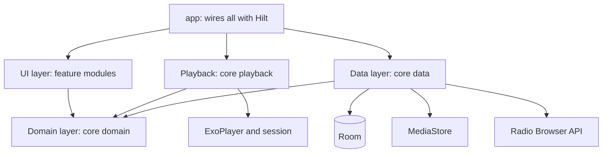
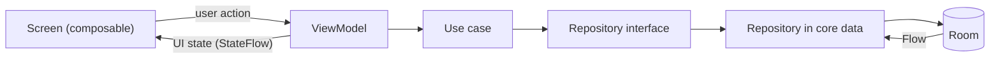
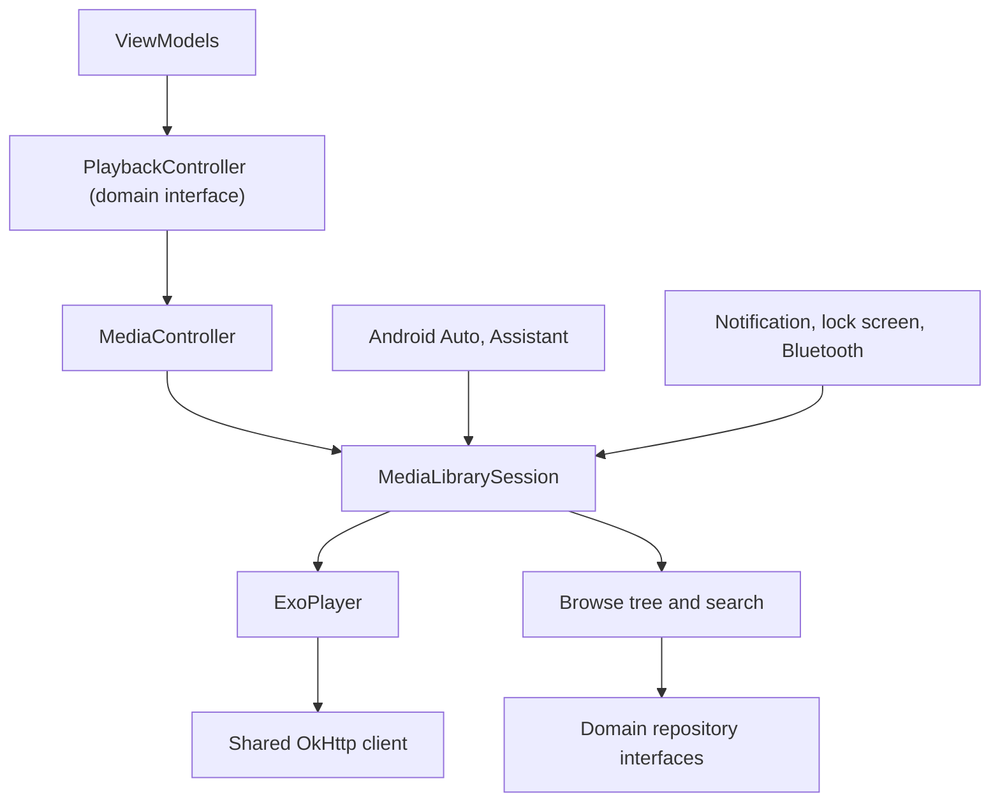

# Tarangini: architecture and folder structure

This page says how the code is laid out and why. [RULES.md](../RULES.md) turns it into rules with ids. [FEATURES.md](FEATURES.md) says what the app does.

Status: agreed for the start of the build, 19 Nov 2026. Version numbers are not on this page. They live only in `gradle/libs.versions.toml`.

## 1. The shape in one minute

- Google's recommended app architecture: a UI layer, a domain layer and a data layer, with data flowing one way.
- Many small Gradle modules, so the compiler enforces the layers. A feature cannot reach Room, Retrofit or ExoPlayer, because it has no dependency on them.
- One playback service for everything. One ExoPlayer and one `MediaLibrarySession` serve the phone UI, Android Auto, Assistant, Bluetooth, the notification and the lock screen.
- Room is the single source of truth for the library, favourites, playlists, history and stations. The phone and the car read the same repositories.
- Open core. The public code defines interfaces. The private premium module binds real versions through Hilt. Public code never imports premium code.

## 2. Layers



| Layer | Holds | Knows about | Never knows about |
|---|---|---|---|
| UI (`feature:*`, `core:ui`) | Screens, ViewModels, UI state | Domain models, use cases, `PlaybackController` | Room, Retrofit, DataStore, MediaStore, ExoPlayer, Media3 |
| Domain (`core:domain`) | Models, use cases, repository interfaces, `PlaybackController`, `PremiumGate` | Kotlin and coroutines only | Android, any library of the other layers |
| Data (`core:data`) | Repository implementations, Room, MediaStore reader, Radio Browser client, DataStore | Domain | UI, playback |
| Playback (`core:playback`) | The service, the session callback, the browse tree, the player setup | Domain, Media3 | UI, Room, Retrofit |

The dependency rule: every arrow points to the domain. The domain depends on nothing.

## 3. Modules

| Module | Type | Holds | May depend on |
|---|---|---|---|
| `app` | Android app | `Application`, the one `Activity`, the navigation graph, Hilt wiring, the `core` and `play` flavours | Every module |
| `feature:home` | Android library | Home screen | `core:domain`, `core:ui` |
| `feature:library` | Android library | Songs, albums, artists, folders, playlists, favourites screens | `core:domain`, `core:ui` |
| `feature:radio` | Android library | Radio directory, India section, add station screens | `core:domain`, `core:ui` |
| `feature:player` | Android library | Mini player, now playing, queue, equalizer screens | `core:domain`, `core:ui` |
| `feature:search` | Android library | Search screen | `core:domain`, `core:ui` |
| `feature:settings` | Android library | Settings, folder picker, open source licences | `core:domain`, `core:ui` |
| `core:domain` | Kotlin JVM library | Models, use cases, repository and service interfaces | Nothing but Kotlin, coroutines and `javax.inject` |
| `core:data` | Android library | Repository implementations and every data source | `core:domain` |
| `core:playback` | Android library | `MediaLibraryService`, session callback, browse tree, audio processors, `PlaybackController` implementation | `core:domain` |
| `core:ui` | Android library | Theme, design tokens, shared composables (song row, station tile, empty and error states) | `core:domain` (models only) |
| `core:testing` | Kotlin and Android library | Fakes of every repository interface, test rules, sample data | `core:domain` |
| `build-logic` | Included build | Convention plugins, so module build files stay a few lines long | - |
| `premium` (private repo) | Android library | The ten premium features, Play Billing, Cast, Crashlytics | `core:domain`, `core:ui` |

Rules that follow from the table:

- A feature module never depends on another feature module. Features meet only in the navigation graph in `app`.
- A feature module never depends on `core:data` or `core:playback`. It gets its data through use cases and controls playback through `PlaybackController`, both from `core:domain`.
- `core:data` and `core:playback` never depend on each other. The playback service reads the library through the same domain repository interfaces as the UI.
- A build check fails when a module breaks this table (rule A2 in `RULES.md`).

## 4. Folder structure

`<base>` is the base package: `com.siliconcircuits.tarangini`.

```text
tarangini/
├── app/
│   └── src/
│       ├── main/kotlin/<base>/
│       │   ├── TaranginiApp.kt          Application, Hilt entry
│       │   ├── MainActivity.kt
│       │   ├── navigation/                nav graph, bottom bar, routes
│       │   └── di/                        app wide Hilt modules
│       ├── core/kotlin/<base>/di/         core flavour: "not available" bindings
│       └── play/                          play flavour: only pulls in :premium
├── feature/
│   ├── home/
│   ├── library/
│   │   └── src/
│   │       ├── main/kotlin/<base>/feature/library/
│   │       │   ├── songs/
│   │       │   │   ├── SongsScreen.kt     stateful entry + stateless content
│   │       │   │   ├── SongsViewModel.kt
│   │       │   │   └── SongsUiState.kt    state, events
│   │       │   ├── albums/
│   │       │   ├── artists/
│   │       │   ├── folders/
│   │       │   ├── playlists/
│   │       │   ├── favourites/
│   │       │   └── navigation/            LibraryNavigation.kt (routes this feature offers)
│   │       ├── main/res/values/strings.xml
│   │       └── test/kotlin/...            ViewModel and screenshot tests
│   ├── radio/
│   ├── player/
│   ├── search/
│   └── settings/
├── core/
│   ├── domain/
│   │   └── src/main/kotlin/<base>/core/domain/
│   │       ├── model/                     Song, Album, Artist, Folder, Station, Playlist, PlaybackState
│   │       ├── repository/                interfaces only
│   │       ├── usecase/                   one class per use case, grouped by area
│   │       ├── playback/                  PlaybackController interface
│   │       ├── premium/                   PremiumGate, StorageSource, CrashReporter interfaces
│   │       └── common/                    AppResult, dispatcher qualifiers
│   ├── data/
│   │   └── src/main/kotlin/<base>/core/data/
│   │       ├── local/                     Room: database, entity/, dao/, migration/
│   │       ├── mediastore/                MediaStore reader, scanner, content observer
│   │       ├── remote/                    Radio Browser: api, dto/, server picker
│   │       ├── settings/                  DataStore
│   │       ├── repository/                implementations of the domain interfaces
│   │       ├── mapper/                    entity and DTO to domain model
│   │       ├── work/                      WorkManager workers
│   │       └── di/
│   ├── playback/
│   │   └── src/main/kotlin/<base>/core/playback/
│   │       ├── service/                   PlaybackService (MediaLibraryService)
│   │       ├── session/                   session callback, caller check, custom commands
│   │       ├── browse/                    browse tree, MediaId codec, search
│   │       ├── player/                    ExoPlayer setup, audio focus, reconnect, stream resolver
│   │       ├── audio/                     audio processors (equalizer)
│   │       ├── resume/                    save and restore of the queue
│   │       ├── controller/                PlaybackController implementation (MediaController)
│   │       ├── mapper/                    domain model to MediaItem
│   │       └── di/
│   ├── ui/
│   │   └── src/main/kotlin/<base>/core/ui/
│   │       ├── theme/                     colour, type, shape, spacing tokens
│   │       ├── component/                 SongRow, StationTile, EmptyState, ErrorState
│   │       └── util/
│   └── testing/
├── build-logic/convention/                tarangini.android.feature, .android.library, .kotlin.library ...
├── gradle/libs.versions.toml              the only place with version numbers
├── config/                                detekt, lint and licence check settings
├── docs/
│   ├── FEATURES.md
│   ├── ARCHITECTURE.md
│   └── adr/                               one file per design decision made during the build
├── .github/workflows/
├── RULES.md
├── CLAUDE.md
├── README.md
└── LICENSE
```

Inside a feature, code is grouped by screen, not by type. There is no `viewmodels/` or `screens/` folder.

## 5. How one screen works



- Each screen has one immutable `UiState` and one ViewModel. The ViewModel exposes one `StateFlow<UiState>`.
- User actions go up as function calls on the ViewModel. One-off events (navigation, a snackbar) come down through a `Channel`.
- A screen file has a stateful entry composable that gets the ViewModel, and a stateless content composable that takes the state and callbacks. Previews and tests use the stateless one.
- A use case is one class with one public `operator fun invoke`. A ViewModel may call a repository interface directly when the use case would only pass the call through.
- Lists come from Room as `Flow` or as paged data. A screen never loads a whole table.

## 6. Playback



- `PlaybackService` owns the only ExoPlayer and the only `MediaLibrarySession` in the app.
- The phone UI is one more client of the session. A ViewModel sees `PlaybackController`: a `StateFlow` of the playback state and a few commands. It never sees Media3 types.
- The browse tree and the in-car search are built from the same repository interfaces as the phone screens, so both always show the same data.
- A media id is made and read only by the `MediaId` codec in `core:playback/browse`. An id that does not parse is refused.
- The session callback checks who is calling. Only this app, Android Auto, Assistant and the system may connect.
- Radio and local files use the same player. Streams use the Media3 OkHttp data source on the one shared OkHttp client.

## 7. Data

| Store | Used for | Rule |
|---|---|---|
| Room | Library index, favourites, playlists, history, saved stations, saved queue | The single source of truth. Schema JSON is exported and every version bump has a tested migration |
| MediaStore | Finding audio files | Read only by the scanner, which writes to Room. Nothing else queries MediaStore |
| Radio Browser API | Station directory | Called only from `core:data/remote`. Responses are untrusted input |
| DataStore | Settings | One instance per file, typed keys, key names never change |
| Disk cache | Artwork | Size limited |

Entities, DAOs and DTOs are `internal` to `core:data`. Mappers turn them into domain models at the repository edge.

## 8. Dependency injection

- Hilt everywhere. Constructor injection for all our own classes.
- Each `core` module has its own Hilt modules in its `di/` package. Bindings from interface to implementation live next to the implementation.
- Dispatchers are injected with qualifiers (`@IoDispatcher`, `@DefaultDispatcher`), so tests control them.
- The `core` flavour binds `PremiumGate` and `CrashReporter` to versions that do nothing. The `play` flavour takes the bindings from the private `premium` module.

## 9. Testing

| What | How | Where |
|---|---|---|
| Use cases, mappers, parsers, codecs | Plain JVM unit tests with fakes from `core:testing` | `src/test` of the module |
| ViewModels | JVM tests with Turbine and the coroutine test dispatcher | `feature:*` `src/test` |
| DAOs and migrations | Robolectric or instrumented tests on an in-memory database | `core:data` |
| Radio Browser client | Recorded responses on a mock web server | `core:data` |
| Screens | Screenshot tests of the stateless content composable, light and dark, 320dp wide | `feature:*` `src/test` |
| Playback and the browse tree | Media3 test utilities and fake repositories | `core:playback` |
| Main flows end to end | Instrumented test on an emulator in CI | `app` `src/androidTest` |

Fakes are preferred over mocks. A fake of each repository interface lives in `core:testing` and is shared by every module.

## 10. Why this shape

| Choice | Options looked at | Reason |
|---|---|---|
| `core:*` and `feature:*` modules | One module with packages; the first idea in the plan (`app`, `feature-*`, `playback`, `data`, `domain`) | It is the first idea with a `core/` and `feature/` folder split and four more modules (`core:ui`, `core:testing`, `feature:home`, `feature:search`). The compiler enforces the layers, builds run in parallel, and the private premium module has a clean seam to plug into |
| Features depend only on `core:domain` and `core:ui` | Features depend on `core:data` | A screen cannot leak a Room entity or call Retrofit when it cannot see them |
| One `core:data` module | Separate `database`, `network`, `datastore` modules | No feature depends on `core:data`, so the extra split would protect nothing. Packages and `internal` are enough. Split it later if build time asks for it |
| `PlaybackController` interface in the domain | ViewModels hold a `MediaController` | ViewModels stay plain JVM classes with fast tests, and Media3 stays in one module |
| Domain as a plain Kotlin module | Domain as an Android library | It cannot import Android by accident, and its tests need no Android runtime |
