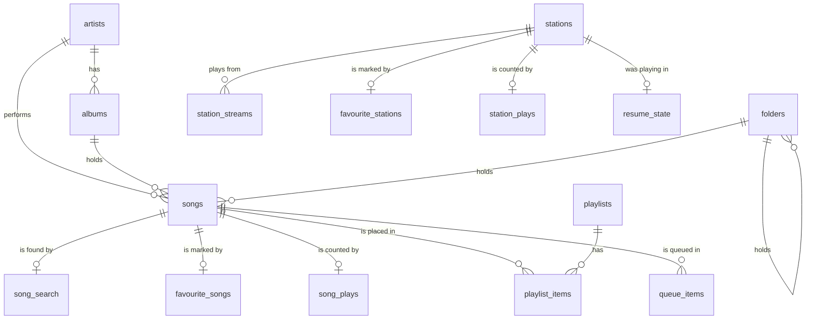

# Tarangini: database design

This page says what the app stores on the phone, in which tables, and why. The code is in `core/data/src/main/kotlin/.../core/data/local`. The exported schema of every version is in `core/data/schemas/`.

Status: version 1, 19 Nov 2026. Rule ids such as D1 are from [CONTRIBUTING.md](../CONTRIBUTING.md#rules-with-ids).

## 1. Context

- One SQLite database on the phone, through Room. One user, one writer process. No server and no sync.
- It holds the library index (a copy of what MediaStore knows), saved stations, favourites, playlists, play counts and the saved play queue.
- Settings are not in the database. They are in a DataStore file (section 9).
- Out of scope for version 1: the repositories, a cache of Radio Browser results, genres, lyrics.

## 2. Numbers and recovery

| Item | Design value | Note |
|---|---|---|
| Songs | 100,000 at most; 500 to 20,000 is normal | About 300 bytes a row, so about 30 MB at the top end |
| Albums, artists, folders | 10,000, 5,000 and 5,000 at most | |
| Search table | One row per song | About 10 MB at the top end |
| Saved stations | Under 1,000 | Favourites, typed in stations and the last 20 played |
| Playlists and places in them | Under 1,000 and under 50,000 | |
| Play counts | One row per song or station that was played | Cannot grow past the library |
| Saved queue | Up to the whole library | Written as a whole in one transaction |
| Writes | A scan writes every changed song in batches; everything else is one row at a time | |
| Loss of the library index | None | It is built again from MediaStore |
| Loss of favourites, playlists and play counts | They are lost with the app data | The app has no backup today. See open question 1 |

## 3. What reads and writes the tables

Every list and search has an index behind it (D2). Tables under 1,000 rows need none.

| Read or write | How often | Served by |
|---|---|---|
| Songs by title, in pages | Hot | `songs(title_key)` |
| Songs by artist, in pages | Hot | `artists(name_key)`, then `songs(artist_id, title_key)` |
| Songs by album, in pages | Hot | `albums(title_key)`, then `songs(album_id, disc_number, track_number)` |
| Songs by date added, by duration | Warm | `songs(date_added)`, `songs(duration_ms)` |
| Songs of one album, in disc and track order | Hot | `songs(album_id, disc_number, track_number)` |
| Songs of one artist | Hot | `songs(artist_id, title_key)` |
| Songs in one folder, folders in one folder | Hot | `songs(folder_id, file_name)`, `folders(parent_id, name)` |
| Albums by title, albums of one artist, with song counts | Hot | `albums(title_key)`, `albums(artist_id, title_key)`; the count uses `songs(album_id, ...)` |
| Artists by name, with song counts | Hot | `artists(name_key)`; the count uses `songs(artist_id, ...)` |
| Search title, artist and album as the user types | Hot | The full text table `song_search` |
| A scan reads the key, change time, size, file name and folder of every stored song, once | Per scan | Unique `songs(source, source_id)`; the folder comes by primary key |
| A scan finds a stored song by its file | Per file | Unique `songs(source, source_id)` |
| A scan saves an artist, an album, a folder | Per file | Unique `artists(name_key)`, `albums(artist_id, title_key)`, `folders(path)` |
| Favourite songs, newest first; is this song a favourite | Hot | `favourite_songs(added_at)`; primary key |
| Favourite stations in the user's order | Hot | `favourite_stations(position)` |
| Songs of a playlist in order | Hot | `playlist_items(playlist_id, position)` |
| Recently played and most played songs | Warm | `song_plays(last_played_at)`, `song_plays(play_count)` |
| Recently played stations | Warm | `station_plays(last_played_at)` |
| A station by its directory id | Warm | Unique `stations(radio_browser_uuid)` |
| Stream URLs of a station | Hot | Unique `station_streams(station_id, position)` |
| Saved queue in order as file ids, the resume state | On start | Primary keys |
| The row id of every song by its file id, to save a new queue | When the queue changed | One pass over `songs` |
| The resume state is written | Every 5 seconds while something plays | Primary key, one row |
| A scan marks songs as gone, gives a song a new file id, removes songs | Per changed file | Primary key |
| A scan removes albums, artists and folders that no song uses | Once, only in a scan that changed or removed a song | The indexes on `songs(album_id, ...)`, `songs(artist_id, ...)`, `songs(folder_id, ...)`, `albums(artist_id, ...)` and `folders(parent_id, ...)` |
| Rows that go when a song or a station goes | Rare | An index on every foreign key column |

Long lists take a limit and an offset. Measured on a development PC with 100,000 songs: no list needs a sort step, the first page of every song list takes under 1 ms, and a page at offset 90,000 takes 55 to 90 ms because the skipped rows are still walked. A phone is several times slower, so the far end of a very large library can take a few tenths of a second. The library screens issue measures this on a phone and moves a list to "rows after this key" if it is too slow.

## 4. Why SQLite through Room

| Option | Result |
|---|---|
| Room 3 on the SQLite that ships with Android | Chosen. Decision D8. No native library is added to the app, and the platform keeps SQLite patched |
| Room 3 with its bundled SQLite | Not now. It gives one SQLite version on every phone and a newer search engine, for about 1 MB more. It can replace the driver in one line later |
| Reading MediaStore for every list | Rejected by D8: no full text search, no joins with favourites, slow lists in the car |

## 5. Tables

Every id is a whole number that the database gives and never uses again. Every time is milliseconds since 1970 UTC, as a whole number. "Key" columns hold a name in the form lists are sorted by (section 6).

| Table | Columns | Unique rules | When its parent goes |
|---|---|---|---|
| `artists` | `id`, `name`, `name_key` | `name_key` | - |
| `albums` | `id`, `title`, `title_key`, `artist_id`, `year` | `artist_id` with `title_key` | An artist with albums cannot be removed |
| `folders` | `id`, `parent_id`, `path`, `name` | `path` | Goes with its parent folder |
| `songs` | `id`, `source`, `source_id`, `title`, `title_key`, `artist_id`, `album_id`, `folder_id`, `file_name`, `mime_type`, `duration_ms`, `size_bytes`, `track_number`, `disc_number`, `year`, `date_added`, `date_modified`, `missing_since` | `source` with `source_id` | An artist, album or folder with songs cannot be removed |
| `song_search` | row id (the song id), `title`, `artist`, `album` | - | Written and removed by the library DAO with the song, in one transaction |
| `stations` | `id`, `source`, `radio_browser_uuid`, `name`, `homepage`, `country_code`, `language`, `tags`, `created_at`, `updated_at` | `radio_browser_uuid` when it is set | - |
| `station_streams` | `id`, `station_id`, `position`, `url`, `codec`, `bitrate_kbps` | `station_id` with `position` | Goes with its station |
| `favourite_songs` | `song_id` (key), `added_at` | One row per song | Goes with its song |
| `favourite_stations` | `station_id` (key), `position` | One row per station | Goes with its station |
| `playlists` | `id`, `name`, `created_at`, `updated_at` | None: two playlists may share a name | - |
| `playlist_items` | `id`, `playlist_id`, `song_id`, `position`, `added_at` | None: a song may be in a playlist twice | Goes with its playlist, and with its song |
| `song_plays` | `song_id` (key), `play_count`, `last_played_at` | One row per song | Goes with its song |
| `station_plays` | `station_id` (key), `play_count`, `last_played_at` | One row per station | Goes with its station |
| `queue_items` | `position` (key), `song_id` | One row per place | Goes with its song |
| `resume_state` | `id` (always 0), `queue_position`, `position_ms`, `station_id`, `shuffle`, `repeat_mode` | One row | `station_id` is emptied when the station goes |

Choices worth a line:

- **`source` and `source_id` on songs.** Today `source` is `LOCAL` and `source_id` is the MediaStore id. A song from cloud storage later gets another source and its own id, in the same tables.
- **Artists and albums are found by their name key, not by a MediaStore id.** So songs from another source join the same artists and albums, and "ABBA" and "Abba" are one artist. The first spelling saved is the one shown.
- **No artist or album tag.** Such songs share the artist row with the empty name, and the album row with the empty title under their artist. The screens show their own "Unknown" text. No column is empty where a list joins on it.
- **Play counts, not a play log.** The app needs "recently played with no repeats" and "most played". One row per song gives both and cannot grow without limit. A full play log can be added later if a feature needs it.
- **Favourites are two tables.** Each has a real foreign key. One mixed table would need a "song or station" column that the database cannot check.
- **A station row is our own copy.** A favourite keeps playing when the directory changes or drops the station.

## 6. Rules that must always hold

| Rule | Held by |
|---|---|
| A file is stored once | Unique `songs(source, source_id)`; saving is "insert, or change the row with this key" in one statement |
| A scan never loses a favourite, a playlist place, a play count or a queue place | Saving never replaces a row, so nothing that points to it is removed. Test: "saving a song again keeps ..." (D3) |
| A song that the settings leave out while its file is on the phone | The scan sets `missing_since` to the mark `HIDDEN_SINCE` (the largest number). Lists leave the song out and it is never removed for good |
| A song whose file is gone | The scan sets `missing_since`; it does not remove the row. Lists leave the song out. Its favourite, playlist, play count and queue rows stay, so a memory card that is taken out and put back loses nothing. When the file is back, saving it empties `missing_since` |
| A song row that is removed for good | Its favourite, playlist, play count and queue rows go with it (foreign keys), and its search row goes in the same transaction. The scanner removes a song for good when its file has been gone for 30 days |
| A playlist song whose file is gone | It keeps its place and is left out of the playlist until the file is back |
| The search table matches the songs | Only the library DAO writes it, in the transaction that saves or removes the song. An artist name and an album title never change in place: a changed tag points the song to another row, and saving the song writes its search row again |
| Every song has an artist and an album that exist | Foreign keys, not empty |
| The resume place survives a missing song | The queue read gives each song with its saved position, and the resume state names that position, not a place in the list that was read |
| An unused album or artist is cleaned up only after a scan has saved all its songs | An album saved for a song that is not saved yet would count as unused. The scanner runs the clean up last |
| One directory station is stored once | Unique `stations(radio_browser_uuid)`; typed in stations have none |
| Sorting is the same on every phone | `title_key` and `name_key` are made by one function, `sortKey`: lower case, one form for each letter, no outer spaces. The index is on the key |
| Two adds at the same moment get different places | The place is "highest place plus one" inside the one insert statement |
| Two plays at the same moment are both counted | `play_count = play_count + 1` inside one statement |
| Search text cannot act as a search operator | `FtsQuery` turns each word into a quoted prefix term and limits the count and length of words (D7) |
| Stored names such as `LOCAL`, `USER`, `ALL` | SQLite through Room has no check rule for them. Only the DAOs write them, from Kotlin enums whose names never change |

## 7. Transactions

- Room starts one transaction for each DAO function marked as a transaction: saving a song with its search row, saving a station with its streams, a new order for a playlist or for favourite stations, replacing the queue.
- The scanner wraps one batch of 500 files in one transaction (D3), through `inOneTransaction` of the library DAO. The block of such a transaction calls only functions of that DAO.
- Nothing calls the network or the file system inside a transaction.
- There is one writer, the app process. Room runs writes one at a time.

## 8. Security and personal data

- The database file is in the app's private folder. No other app can read it.
- It holds what the user listens to: favourites, playlists and play counts. It never leaves the phone (S6). The app sends no analytics.
- It is left out of cloud backup and device transfer by `data_extraction_rules.xml`.
- File names are stored; whole paths of songs are not. Folder paths are stored for the folder view. Nothing from the database is logged (K13).
- Every query uses bound values. No query is built by joining text (D8).
- Stream URLs are stored as given. The player checks the scheme before use (P6).

## 9. Settings store

One DataStore (Preferences) file named `settings`, one instance for the whole app. The keys are in `SettingsKeys`. A key name is never changed and never used again for another meaning (D4); a test pins the names.

| Key | Type | Meaning |
|---|---|---|
| `theme_mode` | text | `system`, `light` or `dark` |
| `dynamic_color` | true or false | Wallpaper colours, or the brand colours |
| `min_track_seconds` | whole number | Shorter files are left out of the library |
| `included_folders` | set of text | When not empty, only these folders are scanned. A folder is a whole path such as `external_primary/Music` and covers the folders inside it |
| `excluded_folders` | set of text | Folders a scan skips |

A key is added by the issue that first uses it.

## 10. Changing the schema

- Every change to an entity raises the database version, adds a migration and adds a test to `SchemaTest`, which builds the old version from its committed schema file and brings it to the new one (D1).
- A schema file on `main` is never edited (H8). CI fails when the schema files in the repo differ from what the entities give.
- A migration that would remove data is split: add the new shape first, remove the old shape in a later release.
- A destructive fallback is never switched on.

## 11. Open questions

| # | Question | What would settle it |
|---|---|---|
| 1 | Favourites, playlists and play counts are lost when the app is removed or the phone is changed, because the app data is left out of backup | A choice between three: keep it so (most private), let Android back up only these tables, or wait for the planned "backup to a file" feature |
| 2 | Whether MediaStore really gives a file a new id after a memory card is put back | A run on a phone with a memory card (manual test 20). The scanner is ready for it: a new file in the folder, with the name and the size, of exactly one song that is gone is taken as that song (ADR 0010) |
