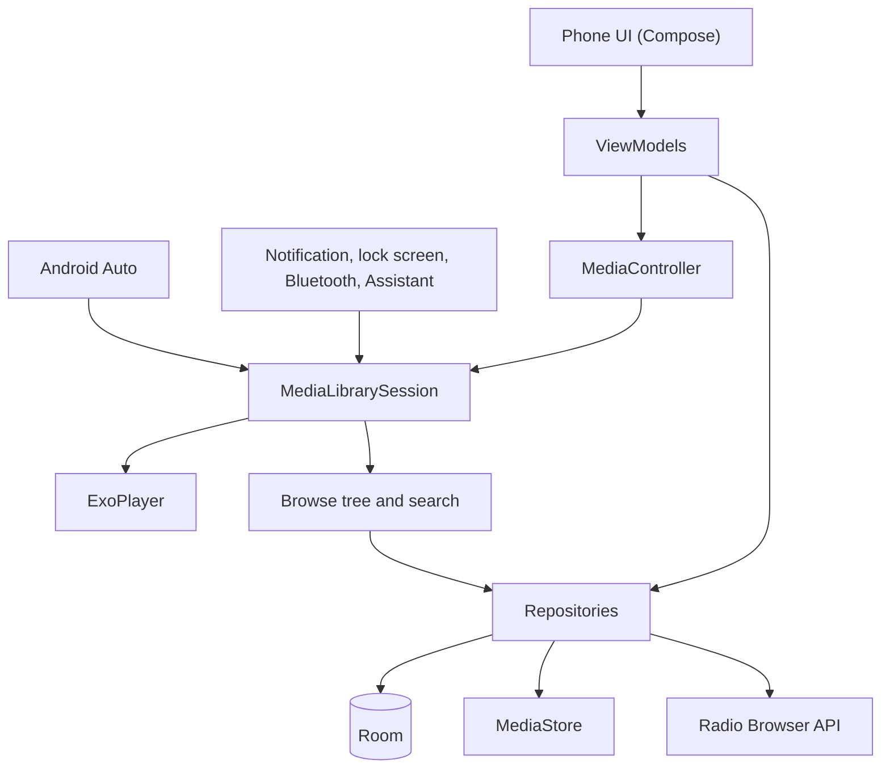

# Tarangini: product and feature plan

Tarangini (Sanskrit: "river", word for word "the one that has waves") is an Android media player for local MP3 and AAC files and for online radio. It works on the phone and in Android Auto. This document says what the app does. [ARCHITECTURE.md](ARCHITECTURE.md) says how the code is laid out, and [CONTRIBUTING.md](../CONTRIBUTING.md#rules-with-ids) holds the rules for the code.

Status: build started, 19 Nov 2026. 18 decisions made (section 8). The work is tracked in GitHub issues under milestones M1 to M10. Section 9 lists the checks still open; each has an issue or is noted there.

## 1. Overview

### Product vision

Tarangini is one simple, fast player for the music on your phone and the radio stations you love, at home and in the car. It plays local files without ads or sign-in, finds stations from India and the world in a few taps, and gives the same library, favourites and queue on the phone screen and in Android Auto. One playback service runs both, so a song or station started on the phone carries on in the car with no break.

### Target users

| User | What they need |
|---|---|
| Daily listeners | A clean library for their own MP3 and AAC files, playlists, resume where they stopped |
| Commuters and drivers | Safe car controls, voice commands, radio that reconnects on weak mobile data |
| Indian regional radio listeners | Easy search by language (Telugu, Tamil, Hindi, Kannada, Malayalam, Marathi, Bengali and more) and by state or city |

### What sets it apart

- Local files and online radio in one app, with one shared queue and one set of favourites.
- Indian regional radio is a first-class part of the app: search and browse by Indian language, not just by country. This comes with the station directory in v1.1.
- Android Auto from day one, not added later.
- No account, no ads and no usage tracking in the free app. Only crash reports are sent. Works offline for local files.
- We publish no station list of our own. Users add stations themselves. From v1.1 they can also pick them from the public Radio Browser directory.
- The core player is open source under GPL-3.0, so anyone can read the code and check what the app does.
- Data saver that is careful with mobile data during long drives.

## 2. Features by module

Priority tags: **[MVP]** first release, **[v1.1]** next release, **[Future]** later or premium. "Phone" and "Auto" show where the feature appears.

### 2.1 Local library

| Feature | Description | Priority | Phone | Auto |
|---|---|---|---|---|
| Storage scan | Read audio from MediaStore. Formats: `.mp3`, `.aac`, `.m4a` | [MVP] | Yes | Uses phone data |
| Auto rescan | Watch MediaStore for changes with a content observer, rescan on app start | [MVP] | Yes | - |
| Browse by songs, albums, artists | Lists with artwork, track count and duration | [MVP] | Yes | Yes |
| Browse by folders | Folder tree built from the file path | [MVP] | Yes | Yes |
| Browse by genres | From the genre tag | [v1.1] | Yes | Yes |
| Search | Search title, artist and album as you type | [MVP] | Yes | Yes (voice and on screen) |
| Sorting | By name, artist, album, date added, duration | [MVP] | Yes | Fixed order |
| Tag fallback | Use the file name when tags are missing | [MVP] | Yes | Yes |
| Embedded lyrics | Show lyrics stored in the file tags | [Future] | Yes | No |

### 2.2 Playback

| Feature | Description | Priority | Phone | Auto |
|---|---|---|---|---|
| Play, pause, seek, next, previous | Standard controls | [MVP] | Yes | Yes |
| Queue | View, reorder, remove, "play next", "add to queue" | [MVP] | Yes | Queue view |
| Shuffle and repeat | Repeat off, one, all | [MVP] | Yes | Yes |
| Gapless playback | No gap between album tracks (ExoPlayer supports this for MP3 with encoder delay headers and for AAC in MP4) | [MVP] | Yes | Yes |
| Resume where you left off | Save queue, track and position; restore on start and on a "resume" from Auto or the system | [MVP] | Yes | Yes |
| Audio focus | Pause on a call, lower volume for navigation prompts, resume after | [MVP] | Yes | Yes |
| Headset and Bluetooth controls | Media buttons, pause when headphones are unplugged ("becoming noisy") | [MVP] | Yes | - |
| Sleep timer | Stop after N minutes or at the end of the track | [v1.1] | Yes | No |
| Playback speed | 0.5x to 2x, mainly for long recordings | [v1.1] | Yes | No |

### 2.3 Online radio

| Feature | Description | Priority | Phone | Auto |
|---|---|---|---|---|
| Station directory | Radio Browser API (community run, free) | [v1.1] | Yes | Yes |
| Search by country, language, genre (tag) | Filters on top of the directory | [v1.1] | Yes | Browse lists and voice |
| Indian regional stations | A ready "India" section: Radio Browser filtered to India and grouped by language and state. We curate nothing ourselves | [v1.1] | Yes | Yes |
| Station icons | No station logos. Each station shows a letter tile in a colour made from its name. A logo appears only if that station gives permission | [MVP] | Yes | Yes |
| Favourite stations | Save, reorder | [MVP] | Yes | Yes |
| Add your own station | Enter a name and a stream URL: HTTP or HTTPS, Icecast, Shoutcast, HLS (`.m3u8`), playlist files (`.pls`, `.m3u`) | [MVP] | Yes | Plays saved ones |
| Import stations | Load many stations at once from an `.m3u`, `.pls` or OPML file | [v1.1] | Yes | - |
| Now playing metadata | Show song title from ICY metadata when the station sends it | [MVP] | Yes | Yes |
| Buffering and reconnect | Clear "buffering" state, retry with backoff on network loss, switch to another stream URL of the same station if one fails | [MVP] | Yes | Yes |
| Station health | Hide stations that Radio Browser marks as broken (`lastcheckok = 0`) | [v1.1] | Yes | Yes |
| Recently played stations | Last 20 stations | [MVP] | Yes | Yes |
| Record a stream | Save a stream to a file | [Future] | Yes | No |

#### Radio Browser: what its pages allow and ask for

Radio Browser is not part of the MVP (decision D24). In the MVP, radio plays only the stations a user adds by name and URL. This table is kept for v1.1.

Checked on 19 Nov 2026 (check C1) at the [API home](https://api.radio-browser.info/), the [API documentation](https://docs.radio-browser.info/) and the [server source](https://gitlab.com/radiobrowser/radiobrowser-api-rust). We ship no station list of our own (decision D3).

| Topic | What the pages say | What we do |
|---|---|---|
| Use in a paid app | "You may use it in free and non free software." No fee, key or sign up is named | Allowed for an app with a paid tier. Radio search stays in the free core in any case |
| Credit | None is asked for | We give it anyway: "Station directory by Radio Browser (radio-browser.info)" on the About screen in Settings and under the radio search results |
| Licence of the station data | Not stated on the pages read. The home page says "You may install it on your own server and mirror all its data" | We show search results and store only the stations a user saves or plays. We do not copy, bundle or host the list. The missing licence text goes to the lawyer with check C2 |
| Licence of the server software | GNU AGPL v3 | We only call the API. No code from the server is ever copied into the app |
| Terms of use, privacy statement | None found | Our privacy text names Radio Browser as the one outside service of the core app, and says what is sent to it |
| Promise of service | "Can be used freely but without guarantee to work". One person keeps it online; "downtimes are possible" | Saved stations, favourites and typed in stations work with no directory. A directory error shows a clear message and a retry |
| Picking a server | Look up `all.api.radio-browser.info` in DNS (or the SRV record `_api._tcp.radio-browser.info`), put the list in random order, use the first, go to the next when a request fails. "Never use a direct link to a single" server. `/json/servers` only for a client that cannot do DNS look ups | As asked. No server name is fixed in the code |
| HTTPS | "HTTP and preferably HTTPS" | HTTPS only |
| `User-Agent` | "Send a speaking http agent string", such as `appname/appversion` | `Tarangini/<version>` on every call |
| Click report | Call `/json/url/{stationuuid}` "everytime when a user starts playing a stream". One count per IP address and station in a day | Called when a station from the directory starts to play, never for a typed in station. This tells Radio Browser the phone's IP address and the station; the privacy text says so |
| Rate limits, caching | None stated. The whole list can be asked for (`/json/stations`) | Searches are sent after a short pause in typing, with a limit and an offset. Country, language and tag lists are kept for a day. We never ask for the whole list |
| Votes and new stations | A vote counts once in 10 minutes per IP address and station. `/json/add` adds a station | Not in the app for now |
| Broken stations | `lastcheckok` gives "the current online/offline state" | `hidebroken=true` on every search |
| Station logos (`favicon`) | "URL to an icon or picture that represents the stream". Nothing on who owns the picture | Not shown. Letter tiles only (decision D3) |

The calls the app needs: `/json/stations/search` (`name`, `countrycode`, `language`, `tag`, `order`, `reverse`, `limit`, `offset`, `hidebroken`), `/json/stations/byuuid`, `/json/countries`, `/json/languages`, `/json/tags` and `/json/url/{stationuuid}`. Of a station we keep `stationuuid`, `name`, `url_resolved` (and `url`), `homepage`, `countrycode`, `language`, `tags`, `codec`, `bitrate` and `hls`.

### 2.4 Android Auto

| Feature | Description | Priority | Phone | Auto |
|---|---|---|---|---|
| Browsable media tree | Root tabs: Library, Radio, Favourites, Recent | [MVP] | - | Yes |
| Artwork | Album art in lists and now playing. Stations show a letter tile, not a logo | [MVP] | - | Yes |
| Voice play | "Hey Google, play Vividh Bharati on Tarangini", "play songs by Ilaiyaraaja on Tarangini" | [MVP] | Yes | Yes |
| In-car search | Search results through the media library search callback | [MVP] | - | Yes |
| Driver safe limits | Short lists, no long text, no settings or forms in the car | [MVP] | - | Yes |
| Custom actions | Favourite toggle, shuffle, repeat buttons on the now playing screen | [v1.1] | - | Yes |
| Content style hints | Grid for albums and stations, list for songs | [v1.1] | - | Yes |
| Android Automotive OS (built into the car) | A separate build target, not the same as Android Auto. Out of the MVP (decision D2) | [Future] | - | Car |

### 2.5 Phone UI

| Feature | Description | Priority | Phone | Auto |
|---|---|---|---|---|
| Jetpack Compose and Material 3 | All screens in Compose | [MVP] | Yes | - |
| Dynamic colour | Material You colours from the wallpaper (every supported phone is Android 12+), with a brand theme as an option | [MVP] | Yes | - |
| Light and dark themes | Follow the system, or pick one | [MVP] | Yes | - |
| Mini player | Bar above the bottom navigation on every screen | [MVP] | Yes | - |
| Full screen now playing | Large art, seek bar, queue, sleep timer, speed | [MVP] | Yes | - |
| Home screen widget | Art, title, play and pause, next. Built with Jetpack Glance | [v1.1] | Yes | - |
| Tablet and foldable layout | Two pane layout for large screens | [Future] | Yes | - |

### 2.6 System integration

| Feature | Description | Priority | Phone | Auto |
|---|---|---|---|---|
| Media notification | Media3 builds it from the session | [MVP] | Yes | - |
| Lock screen controls | From the media session | [MVP] | Yes | - |
| Media session | One `MediaLibrarySession` for the phone, Auto, Assistant, Bluetooth and the system media controls | [MVP] | Yes | Yes |
| Playback resumption | Show Tarangini in the system media controls after reboot (Android 13+) | [v1.1] | Yes | - |
| Wear OS controls | Basic controls show on the watch from the media session. A full watch app is extra work | [Future] | Watch | - |

### 2.7 Audio

| Feature | Description | Priority | Phone | Auto |
|---|---|---|---|---|
| Equalizer and presets | 5 band equalizer built as our own ExoPlayer audio processor, the same on every phone. Presets: Flat, Bass, Vocal, Classical, Carnatic, Bollywood | [v1.1] | Yes | Applies |
| Bass boost | Part of the same audio processor | [v1.1] | Yes | Applies |
| Volume normalization | Use ReplayGain tags when present | [Future] | Yes | Applies |
| Crossfade | Fade between tracks | [Future] | Yes | Applies |

> [!WARNING]
> Needs a short trial build before we commit. The equalizer is our own ExoPlayer audio processor (decision D12), so its CPU cost and sound quality must be measured on real phones. Media3 has no built-in crossfade or ReplayGain. Crossfade needs two players or a custom audio processor and may break gapless playback.

### 2.8 Personalization

| Feature | Description | Priority | Phone | Auto |
|---|---|---|---|---|
| Favourites | Songs and stations | [MVP] | Yes | Yes |
| Recently played | Songs and stations | [MVP] | Yes | Yes |
| Playlists | Create, rename, reorder, delete | [MVP] | Yes | Yes (play only) |
| Most played | Based on play counts | [v1.1] | Yes | Yes |
| Import and export playlists | `.m3u` files | [v1.1] | Yes | - |
| Backup and restore | Favourites, playlists and settings to a file | [Future] | Yes | - |

### 2.9 Settings

| Feature | Description | Priority | Phone | Auto |
|---|---|---|---|---|
| Include and exclude folders | Skip WhatsApp voice notes, call recordings and similar | [MVP] | Yes | - |
| Minimum track length | Hide files shorter than N seconds | [MVP] | Yes | - |
| Stream quality | Prefer low, normal or high bitrate stream when a station has more than one | [v1.1] | Yes | - |
| Data saver on mobile data | Pick the lowest bitrate, smaller buffer, no artwork download on mobile data | [v1.1] | Yes | Applies |
| Cache size | Limit for the artwork cache | [v1.1] | Yes | - |

### 2.10 Premium subscription features [Future]

The core app stays free with no ads. A paid subscription adds the features below (decision D7). They ship after v1.1, through Google Play Billing.

| Feature | Description |
|---|---|
| Stream recording | Record radio to a file. Needs a legal check first |
| Advanced equalizer | 10 band EQ, custom presets |
| Cloud backup and sync | Favourites, playlists and settings saved as a file in the user's own connected storage (WebDAV, S3, OneDrive). No server of ours. Last change wins, with a simple merge for playlists |
| Extra themes | Extra colour themes and now playing styles |
| Pause and rewind live radio | Keep the last 30 minutes of a station on the phone, to pause for a call or replay a song. No server. Needs a spike: ExoPlayer has no ready buffer for Icecast streams |
| Radio alarm and schedule | Wake up to a station or start one at a set time. Falls back to a local sound with no internet. Needs an exact alarm permission |
| Sound profile per device | Remember equalizer and volume for each output (car Bluetooth, headphones, speaker) and switch when it connects. Built on our own equalizer |
| Smart playlists | Playlists that fill by rules: most played, not played in 30 days, added this month, by genre or folder |
| Cast to speakers and TV | Chromecast and Google Cast through `media3-cast` and Google Play services |
| Play from your own cloud storage | Connect your own storage and play songs from it like local files: Nextcloud and other WebDAV servers, S3 and S3 compatible stores (MinIO, Backblaze B2, Wasabi), OneDrive. Google Drive is left out at first (decision D17). The phone talks directly to the storage. We run no server and never see the files |

How cloud storage playback is planned:

| Topic | Plan |
|---|---|
| Design | One `StorageSource` interface in the data layer (list a folder, open a file as a stream with range requests). Local MediaStore and each cloud type sit behind it, so the library, queue and Android Auto do not care where a song lives |
| Playback | ExoPlayer streams over HTTPS with the provider's auth header. A size limited disk cache avoids downloading a song twice. "Keep offline" for chosen folders can come later |
| Library | Browse by folders first. Tags (title, artist, album) are read in the background with small range requests and stored in Room |
| Sign-in | WebDAV: URL, user and app password. S3: endpoint, bucket, access key and secret key. OneDrive: Microsoft sign-in with a read only scope |
| Security | HTTPS only. Tokens and keys are encrypted with the Android Keystore, never logged, never backed up. Read only scopes. Advise a read only S3 key |
| Order | 1. WebDAV and S3 (no outside review needed). 2. OneDrive. Google Drive is not in the first version |
| Data use | Follows the data saver setting. Warn before streaming large files on mobile data |

Google Drive, not sure, check before adding it later: full read access to Google Drive uses a restricted scope, and Google asks for app verification plus a yearly paid security assessment for it. The narrower `drive.file` scope only reaches files the user picks one by one. This is why Google Drive is left out at first.

Looked at and left out for now: song history from radio, synced lyrics, tag editor.

The app is open core (decision D5). The ten premium features, Play Billing, Cast and Crashlytics live in a private `premium` module that only the Play build includes. The subscription has a monthly and a yearly plan (decision D14). It is checked on the phone through Play Billing, with the purchase signature verified (decision D16). The Play build is shrunk and obfuscated with R8.

## 3. Technical architecture (high level)

### 3.1 Stack

| Area | Choice |
|---|---|
| Language | Kotlin |
| UI | Jetpack Compose, Material 3, Navigation Compose, Glance for the widget |
| Pattern | MVVM with clean architecture layers: UI, domain (use cases), data (repositories) |
| Playback | AndroidX Media3: ExoPlayer, `MediaLibraryService`, `MediaLibrarySession`. Extra modules: `media3-exoplayer-hls` |
| Local scan | MediaStore (`MediaStore.Audio`) |
| Database | Room for library index, favourites, playlists, play history, saved stations |
| Network | Retrofit with OkHttp and kotlinx.serialization for Radio Browser |
| Crash reports | Firebase Crashlytics, crash reports only, no usage analytics |
| App languages | English first. Every text in string resources, ready for Hindi, Telugu and others in v1.1 |
| Images | Coil for artwork in Compose; bitmaps for Auto through the session artwork |
| DI | Hilt |
| Settings | Jetpack DataStore (Preferences) |
| Background work | WorkManager for rescans and station list refresh |

Versions: use the latest stable versions of Kotlin, the Compose BOM, Media3 and AGP when the build starts. They are not pinned here.

### 3.2 Main idea

One `MediaLibraryService` holds one ExoPlayer and one `MediaLibrarySession`. Every client talks to that session: the phone UI (through a `MediaController`), Android Auto, Google Assistant, Bluetooth, the notification, the lock screen and Wear OS. The service builds the browse tree from the same repositories the phone UI uses, so both always show the same data.

### 3.3 Component diagram

### 3.4 Modules

The full module table, the dependency rules and the folder structure are in [ARCHITECTURE.md](ARCHITECTURE.md) (decision D18). In short:

| Module | Holds |
|---|---|
| `app` | Activity, navigation, Hilt setup, the `core` and `play` builds |
| `feature:home`, `feature:library`, `feature:radio`, `feature:player`, `feature:search`, `feature:settings` | Screens and ViewModels. Depend only on `core:domain` and `core:ui` |
| `core:domain` | Models, use cases and interfaces, in plain Kotlin |
| `core:data` | Room, MediaStore reader, Radio Browser client, DataStore |
| `core:playback` | `MediaLibraryService`, session callback, browse tree, audio focus |
| `core:ui` | Theme and shared composables |
| `core:testing` | Fakes and test helpers |
| `premium` (private repo) | The ten premium features, Play Billing, Cast, Crashlytics. Plugs into interfaces that the public modules define |

## 4. Android Auto requirements and constraints

Checked against Google's pages on 19 Nov 2026 (check C3). Each row names its source page; the links are below the table. "Not stated" means the page gives no number, so the row is our own choice.

| Topic | What Google says | What we do | Source |
|---|---|---|---|
| Root tabs | The car gives the limit in the root hints. "In most cases, expect this number to be four". More tabs may be dropped. With no hint, assume at most four | 4 tabs: Library, Radio, Favourites, Recent. Read the limit from the root hints and drop from the end if it is lower | [Hierarchy] |
| Tab icons and labels | Monochrome icons, white preferred. Short labels | White vector icons, one word labels | [Hierarchy] |
| Tree depth | Not stated | Our choice: about 3 levels below the root | [Hierarchy] |
| List size | "Strict limits on how many media items can be displayed at each level". No number is given, and it differs by car | Most useful items first. Long lists (all songs) are split by letter or shown as "recent" and "most played", never as one list of thousands | [Hierarchy] |
| Paging | Android Auto does not support paging. Do not rely on `page` and `pageSize` | Each node returns its whole, short list | [Hierarchy] |
| Browsable and playable | An item can be browsable, playable, or both. An item that is both works like a playlist | Our choice: each item is one or the other. Simpler to test | [Media] |
| Artwork | A local URI only: `content://` or `android.resource://`, pointing to a bitmap or a vector drawable. No bitmaps in the item itself (1 MB binder limit). No size is stated | A content provider serves album art and letter tiles. Our choice of size: 320 px, checked in the Desktop Head Unit | [Artwork] |
| Text length | No number. The car cuts long text. Text must not scroll by itself (ST-1) | Title and one subtitle, short | [Quality] |
| List or grid | Content style hints for browsable and playable items, and group titles. Items of one group must be next to each other | Grid for albums and stations, list for songs | [Styles] |
| Voice | "All apps must support voice searches". An empty query means "play some music" and must start playback. Do not block while searching. Gemini and Google Assistant commands must work (VC-1) | Search in the session callback and the `MEDIA_PLAY_FROM_SEARCH` filter. An empty query resumes the last queue | [Voice], [Search] |
| Start of playback | The app must not start playing by itself when the car connects (MA-1). It keeps the last state so the user can carry on | No auto play on connect. The saved queue and place are restored, paused | [Playback], [Quality] |
| Response times | A button answers within 2 seconds (DR-1). The app starts within 10 seconds (DR-2) and loads content within 10 seconds (DR-3) | Browse reads only the database. A slow stream shows a buffering state at once | [Quality] |
| Errors | Set the error state with a code and a message in the user's language. If the user must use the phone, the message says so. A message to look at the phone only when it is safe (VI-1) | "No internet", "Allow access to audio files on your phone, when it is safe" and the like, through the session | [Errors], [Quality] |
| Driver safety | No moving pictures or video (SA-1), no text ads (AD-1), no pictures other than art and icons (IU-1), only useful notifications (IN-1, NA-1) | No video, no ads, no sign-in or settings in the car | [Quality] |
| Colours and icons | Contrast, white icon sets and colour rules (VD-1 to VD-3) | White icons, the car's own colours | [Quality] |
| Manifest | An exported service with the `android.media.browse.MediaBrowserService` action. Media3 `MediaLibraryService` is supported. A one colour attribution icon through the `androidx.car.app.TintableAttributionIcon` meta-data | One `MediaLibraryService` with both intent filters, and the attribution icon | [Manifest] |
| Car app descriptor | Not on the pages read on this date | `res/xml/automotive_app_desc.xml` with `<uses name="media"/>`, linked by the `com.google.android.gms.car.application` meta-data. Confirmed when the app shows in the Desktop Head Unit | - |
| Custom actions | No fixed number. Extra playback actions go to an overflow menu. For actions on browse items the car gives the limit in the root hints; 0 means not supported | Favourite, shuffle and repeat on the now playing screen. Browse actions only when the car allows them | [Actions] |
| Play Store review | An extra review against the car app quality rules. For a media app: PC-1, EP-1, EP-2, SA-1, AD-1, IU-1, VI-1, ST-1, VC-1, DR-1 to DR-3, VD-1 to VD-3, GB-1, MA-1, NA-1, IN-1 | The quality pass records a result for each of these | [Quality] |
| Testing | Desktop Head Unit 2.x from the SDK Manager. Turn on Android Auto developer mode on the phone. Over USB: `desktop-head-unit --usb`. Over ADB: start "head unit server" on the phone, `adb forward tcp:5277 tcp:5277`, then `desktop-head-unit` | The same, plus the "Media Controller Test" app, plus a real car before release | [Testing] |

[Media]: https://developer.android.com/training/cars/media
[Hierarchy]: https://developer.android.com/training/cars/media/create-media-browser/content-hierarchy
[Styles]: https://developer.android.com/training/cars/media/create-media-browser/content-styles
[Artwork]: https://developer.android.com/training/cars/media/create-media-browser/media-artwork
[Search]: https://developer.android.com/training/cars/media/create-media-browser/browsable-search
[Actions]: https://developer.android.com/training/cars/media/create-media-browser/custom-browse-actions
[Voice]: https://developer.android.com/training/cars/media/voice-actions
[Errors]: https://developer.android.com/training/cars/media/errors
[Manifest]: https://developer.android.com/training/cars/media/configure-manifest
[Playback]: https://developer.android.com/training/cars/media/enable-playback
[Quality]: https://developer.android.com/docs/quality-guidelines/car-app-quality
[Testing]: https://developer.android.com/training/cars/testing/dhu

> [!NOTE]
> The rules that apply only to Android Automotive OS (the car's own system) are left out; that build is not part of the MVP. Check this table again before the Play release, because Google changes these pages.

## 5. Permissions and policies

### 5.1 Permissions

| Permission | Why | Notes |
|---|---|---|
| `READ_MEDIA_AUDIO` | Read audio files on Android 13+ | Runtime permission |
| `READ_EXTERNAL_STORAGE` | Read audio files on Android 12 and 12L (API 31, 32) | Set `android:maxSdkVersion="32"` |
| `FOREGROUND_SERVICE` | Keep playing in the background | Normal permission |
| `FOREGROUND_SERVICE_MEDIA_PLAYBACK` | Needed on Android 14+ | Service declares `android:foregroundServiceType="mediaPlayback"` |
| `POST_NOTIFICATIONS` | Android 13+ | Media session notifications are exempt, so we only need it if we add other notifications |
| `INTERNET` | Radio and the station directory | Normal permission |
| `ACCESS_NETWORK_STATE` | Know Wi-Fi vs mobile data for data saver, and when to reconnect | Normal permission |
| `WAKE_LOCK` | Keep the CPU awake during playback | ExoPlayer wake mode: `WAKE_MODE_LOCAL` for a file, `WAKE_MODE_NETWORK` for a stream |
| `RECEIVE_BOOT_COMPLETED` | WorkManager puts the rescan job back after the phone restarts | Normal permission. Comes from the manifest of WorkManager |
| `SCHEDULE_EXACT_ALARM` or `USE_EXACT_ALARM` | Radio alarm (premium, Future) | Not sure which one Play allows for a player with an alarm. `USE_EXACT_ALARM` is only for alarm clock and calendar apps. Check the policy before building |

We do not need `MANAGE_EXTERNAL_STORAGE`. Play rejects it for media players.

### 5.2 Play Store policy notes

- **Target API level.** Play needs a recent target SDK for new apps and updates. Check the current required level at release time.
- **Foreground service declaration.** For target SDK 34+, declare the `mediaPlayback` service type in Play Console with a short video of how it is used.
- **Data safety form.** Declare crash logs (Firebase Crashlytics). No usage analytics and no personal data.
- **Content and copyright.** We play streams that stations make public. We do not host or record content in the free app. Station names and logos belong to the stations. We show no logo without permission and publish no station list of our own. Recording needs a legal check before it ships.
- **Families policy.** Do not target children, so we avoid the stricter rules.
- **Android Auto review.** Extra review, see section 4.

## 6. Source code and releases

The app is open core (decision D5). The core player is open source. The premium features are closed.

| Part | Where | Licence | Holds |
|---|---|---|---|
| Core | Public GitHub repo | GPL-3.0 (version 3 only) | Library, playback, radio, Android Auto, phone UI, the 5 band equalizer, settings. Everything tagged [MVP] and [v1.1] |
| Premium | Private GitHub repo | All rights reserved | The ten premium features, Play Billing, Cast, Crashlytics |

| Topic | Plan |
|---|---|
| Two builds | `core`: built from the public repo alone, a complete free app with no closed source libraries. `play`: core plus the private premium module, the build that goes to the Play Store |
| The boundary | The public code defines interfaces (for example `StorageSource`, the equalizer band count, a `PremiumGate`). The core build binds them to "not available". The premium module binds the real ones through Hilt. Public code never imports premium code |
| Why GPL-3.0 | Anyone who ships the core, changed or not, must publish all of it under GPL-3.0. Nobody else can add closed features on top. The owner alone can ship it with closed code (the premium module, Play Billing), because the owner holds the right to relicense every line (decision D31) |
| Third party code | Apache-2.0, MIT, BSD and MPL-2.0 libraries only. No GPL or AGPL code of others, because the Play build mixes in closed code and we cannot relicense what is not ours |
| Contributions | Public issues and pull requests on the core. Every contributor agrees to the contributor agreement (`docs/CLA.md`) before the first merge. Without it the closed Play build would break the licence of their code. Today the agreement is the tick line in the pull request form; a CLA bot with a required check comes before outside contributions are invited |
| Name and logo | The licence covers the code, not the name. Add a short trademark note in the README, and consider registering "Tarangini" and the logo |
| Licence notices | An "Open source licences" screen in Settings that lists every library and its licence text |
| Secrets | No keys in either repo. `google-services.json`, the signing key and the Play upload key live only in GitHub Actions secrets of the private repo |
| CI | Public repo: build, unit tests and lint of the `core` build on every PR. Private repo: the `play` build and the signed release AAB on every version tag |
| Releases | Play Store only for now (decision D6). The `core` build could go to GitHub Releases or F-Droid later |
| Station list | None of our own. Stations come from the user or from Radio Browser |
| What open core does not stop | Anyone may build the free core, or write their own version of a premium feature on top of it. Whatever they ship that holds our code must be open under GPL-3.0, and it needs another name |

## 7. Milestone roadmap

| Milestone | Goal | Main items |
|---|---|---|
| MVP | A stable player for local files and radio that passes the Android Auto review | Library scan and browse, core playback, queue, resume, radio stations the user adds by name and URL, favourites, ICY metadata, reconnect, Auto browse tree, voice play, search, notification, Material 3 UI with mini player |
| v1.1 | Daily use comfort and data care | The radio directory (Radio Browser) with the India section, genres, sleep timer, speed, equalizer and bass boost, widget, most played, playlist import and export, station import, stream quality, data saver, cache size, Auto custom actions, playback resumption |
| Future | Grow reach and test a paid tier | Android Automotive OS build, Wear OS app, tablet layout, crossfade, normalization, lyrics, stream recording, backup and sync, premium subscription with Play Billing |

## 8. Decisions made

| # | Decision | Date | Effect |
|---|---|---|---|
| D1 | minSdk 31 (Android 12) | 19 Nov 2026 | Dynamic colour on every phone. Less old code. `READ_EXTERNAL_STORAGE` is still needed for API 31 and 32 only |
| D2 | Android Auto only for MVP | 19 Nov 2026 | One APK for phone and car. Android Automotive OS stays in Future |
| D3 | Users add stations (name and URL) or pick them from Radio Browser. We ship no station list of our own. Replaces the earlier "our own checked India list" choice | 19 Nov 2026 | Lower legal risk. The India section is only a Radio Browser filter |
| D4 | Free core app with no ads | 19 Nov 2026 | No Play Billing in MVP or v1.1 |
| D5 | Open core: public core, premium module private. The licence of the core was MPL-2.0 at first and is GPL-3.0 since D31 | 19 Nov 2026 | Two repos and two builds (`core`, `play`). No GPL or AGPL libraries |
| D6 | Publish on the Play Store only for now | 19 Nov 2026 | The `play` build may use Google libraries. The `core` build could go to GitHub Releases or F-Droid later |
| D7 | Premium subscription after v1.1 with ten features: stream recording, advanced equalizer, cloud backup and sync, extra themes, pause and rewind live radio, radio alarm and schedule, sound profile per device, smart playlists, cast, play from your own cloud storage | 19 Nov 2026 | Play Billing in the one build. Sync needs a backend. Core features never move behind the paywall |
| D8 | Copy the local library into Room and keep it in sync with MediaStore | 19 Nov 2026 | Fast search and Auto lists. Cloud songs fit the same tables |
| D9 | Retrofit with OkHttp | 19 Nov 2026 | One HTTP client shared with Media3 streams |
| D10 | Crash reports only, with Firebase Crashlytics | 19 Nov 2026 | No usage analytics. Data safety form declares crash logs |
| D11 | English first, strings ready for translation | 19 Nov 2026 | Other languages from v1.1 |
| D12 | Equalizer as our own ExoPlayer audio processor | 19 Nov 2026 | Same sound on every phone. Needs a trial build first |
| D13 | No station logos unless the station gives permission | 19 Nov 2026 | Letter tiles for stations in lists, now playing and Android Auto |
| D14 | Subscription with monthly and yearly plans | 19 Nov 2026 | Prices set closer to launch |
| D15 | Backup and sync stored in the user's own cloud storage | 19 Nov 2026 | No server of ours and no user data held by us |
| D16 | Subscription checked on the phone through Play Billing | 19 Nov 2026 | No server. Purchase signature verified, R8 obfuscation |
| D17 | Google Drive left out of cloud storage at first | 19 Nov 2026 | Launch with WebDAV, S3 and OneDrive. Revisit after reading Google's rules |
| D18 | Module structure: `app`, `feature:*` and `core:*` modules, with features depending only on `core:domain` and `core:ui`. Options and reasons are in section 10 of [ARCHITECTURE.md](ARCHITECTURE.md) | 19 Nov 2026 | The compiler enforces the layers. `CONTRIBUTING.md` holds the rules with ids |
| D19 | Navigation Compose with typed routes. Four tabs as in the approved design (Home, Library, Radio, Favourites). Back from the first screen of a tab leaves the app. See [ADR 0001](adr/0001-navigation-and-tabs.md) | 19 Nov 2026 | Each feature offers its routes in its `navigation/` package. Settings opens from the Home top bar |
| D20 | Screenshot tests with Robolectric and Roborazzi, run by `./gradlew test`. See [ADR 0002](adr/0002-screenshot-tests.md) | 19 Nov 2026 | Saved pictures are committed in `src/test/screenshots/` |
| D21 | Database version 1: Room 3 on the phone's own SQLite, a song whose file is gone is marked and not removed, play counts and not a play log. See [DATABASE.md](DATABASE.md) and [ADR 0003](adr/0003-database.md) | 19 Nov 2026 | A rescan or a memory card that is taken out never costs favourites, playlists or play counts |
| D22 | Android Auto limits checked at the source (check C3). No paging in the car, artwork only as local URIs, no auto play on connect, tab limit read from the root hints. Tree depth and "browsable or playable, never both" stay as our own choices | 19 Nov 2026 | Section 4 has the limits and their source pages; the Auto issues were updated |
| D23 | Radio Browser checked at the source (check C1): it may be used in paid software and asks for no credit. We credit it anyway, send click reports only for directory stations, use HTTPS only and never ask for the whole list. | 19 Nov 2026 | Section 2.3 has the rules; the privacy text must name Radio Browser and the click report |
| D24 | Radio Browser stays out of the MVP (owner). Radio in the MVP plays only stations the user adds by name and URL. The station directory, its search and the India section move to v1.1 | 19 Nov 2026 | Issues #25 and #26 moved to v1.1. In the MVP the core app makes one kind of outside call: the stream the user picked |
| D25 | The playback service: Media3 1.11.1, one player and one session. This app may do everything; callers the system trusts for media control may connect with the transport controls only; every other app is refused. A caller can play only MediaStore audio items. See [ADR 0004](adr/0004-playback-service-and-session-access.md) | 19 Nov 2026 | Android Auto and Assistant are let in by signing certificate with the Auto setup |
| D26 | Screens reach the player only through `PlaybackController` in the domain. One connection for the whole app, open while a screen is open. See [ADR 0005](adr/0005-playback-connection.md) | 19 Nov 2026 | Commands for shuffle and repeat come with the screen that needs them |
| D27 | Audio focus, the pause when headphones are unplugged and the media buttons are left to ExoPlayer and the Media3 session; no audio focus code of ours. See ADR 0004 | 19 Nov 2026 | The checks a person must do on a real phone are in [MANUAL-TESTS.md](MANUAL-TESTS.md) |
| D28 | The queue lives only in the player. Screens change it through `PlaybackQueue` in the domain; there are no use cases that only pass a call on. A long list starts with 20 items and gets the rest in parts of 5,000 once sound is out. See [ADR 0006](adr/0006-queue.md) | 19 Nov 2026 | Open: a very long queue makes the system (Bluetooth) work on every item; see the ADR |
| D29 | Gapless playback is proven with test albums. The audio renderer corrects the start and end silence of MP3 files for the MP3 decoder of Android, because Media3 and that decoder both cut the decoder delay. See [ADR 0007](adr/0007-gapless-playback.md) | 19 Nov 2026 | Files with no delay header keep a gap of about 40 ms: a known limit |
| D30 | Only the Library tab asks for the audio permission, after a reason screen. Four states; "denied for good" is worked out from the answers of Android, with no saved flag. See [ADR 0008](adr/0008-audio-permission.md) | 19 Nov 2026 | Open: a run on the API 31 and 33 emulator images |
| D31 | The public core is under GPL-3.0 (version 3 only) with a contributor agreement. The owner keeps the right to relicense and ships the Play build with the closed premium module (dual licensing). Replaces MPL-2.0 from D5 | 19 Nov 2026 | `LICENSE`, the header of every source file and the header check changed. No outside contribution is merged without the agreement. GPL and AGPL libraries of others stay forbidden. See `docs/adr/0009-licence-gpl3.md` |
| D32 | A scan writes only the difference between MediaStore and the library, 500 songs in a transaction. A song whose file is gone is kept for 30 days. A file that comes back under a new id is matched by folder, name and size. A song the settings hide is never removed. See [ADR 0010](adr/0010-library-scan.md) | 20 Nov 2026 | A scan with no change writes nothing, and favourites and playlists survive a memory card that is taken out |
| D33 | The playback service saves the queue and the place in it to Room, and brings them back paused when it starts. A play request with an empty player gets the saved queue. An item whose file is gone is skipped. See [ADR 0011](adr/0011-resume.md) | 20 Nov 2026 | The app opens with the last queue, item and position, and a headset button starts it when the app is not running |
| D34 | The library rescans by itself: at every start of the app, 2 seconds after the audio files changed while the app runs, and through one WorkManager job that the system starts only after a change while the app is closed. See [ADR 0012](adr/0012-auto-rescan.md) | 20 Nov 2026 | New and deleted songs show with no action of the user. No job runs on a timer |

## 9. Checks before building

All open questions are answered. These points still need a check at the source or a short trial build.

| # | Check | Why |
|---|---|---|
| C2 | A lawyer's view before the paid tier | Linking to public streams, showing station names, stream recording, and use of the Radio Browser data, whose licence its pages do not state |
| C4 | Exact alarm permission for the radio alarm | Play allows `USE_EXACT_ALARM` only for some app types |
| C5 | Trial builds | Our own equalizer processor, the pause and rewind buffer for live radio, crossfade with gapless |
| C6 | Play target API level and foreground service declaration | Rules at release time |
| C7 | Subscription prices | Monthly and yearly amounts |
| C8 | Google Drive rules, if it is added later | Verification and yearly assessment cost |
| C9 | Open core licence review | A lawyer confirms GPL-3.0 with dual licensing for the core, the contributor agreement text and the trademark note |
