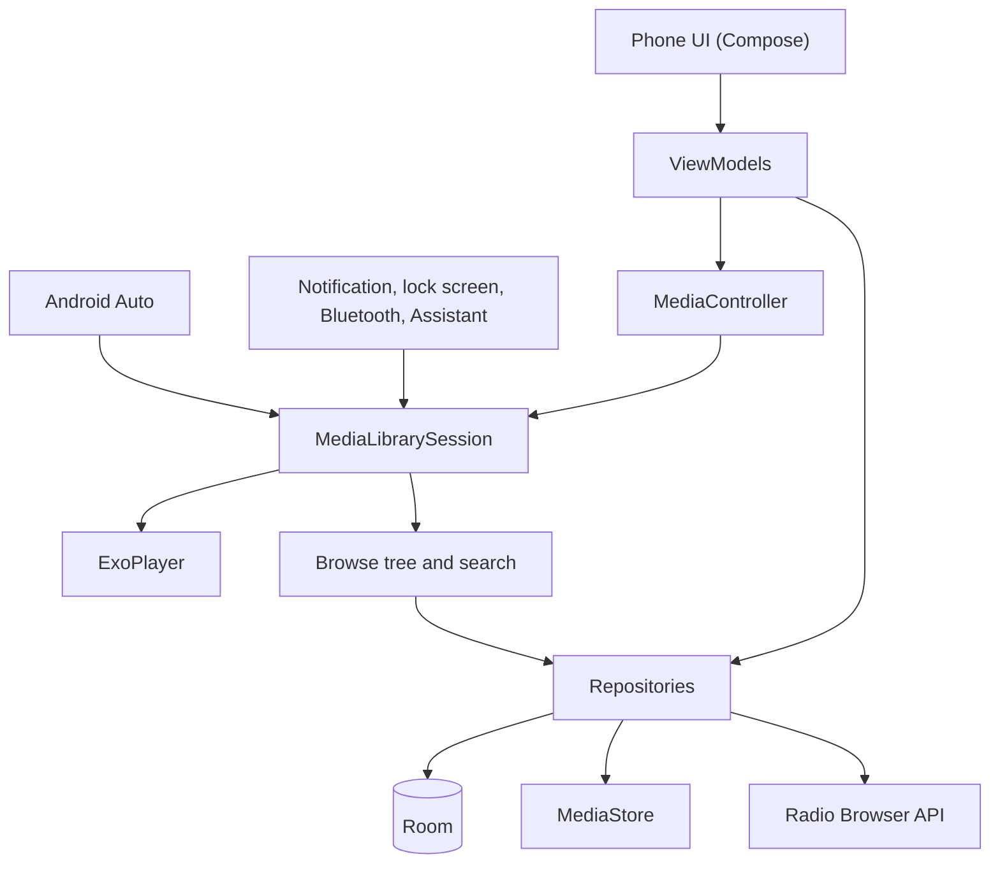

# Swara Tarang: product and feature plan

Swara Tarang (Sanskrit: "waves of musical notes") is an Android media player for local MP3 and AAC files and for online radio. It works on the phone and in Android Auto. This is a planning document. It has no app code.

Status: draft, 19 Nov 2026. 17 decisions made (section 8). No open questions are left; section 9 lists the checks to do before building.

## 1. Overview

### Product vision

Swara Tarang is one simple, fast player for the music on your phone and the radio stations you love, at home and in the car. It plays local files without ads or sign-in, finds stations from India and the world in a few taps, and gives the same library, favourites and queue on the phone screen and in Android Auto. One playback service runs both, so a song or station started on the phone carries on in the car with no break.

### Target users

| User | What they need |
|---|---|
| Daily listeners | A clean library for their own MP3 and AAC files, playlists, resume where they stopped |
| Commuters and drivers | Safe car controls, voice commands, radio that reconnects on weak mobile data |
| Indian regional radio listeners | Easy search by language (Telugu, Tamil, Hindi, Kannada, Malayalam, Marathi, Bengali and more) and by state or city |

### What sets it apart

- Local files and online radio in one app, with one shared queue and one set of favourites.
- Indian regional radio is a first-class part of the app: search and browse by Indian language, not just by country.
- Android Auto from day one, not added later.
- No account, no ads and no usage tracking in the free app. Only crash reports are sent. Works offline for local files.
- We publish no station list of our own. Users add stations themselves or pick them from the public Radio Browser directory.
- The core player is open source under MPL-2.0, so anyone can read the code and check what the app does.
- Data saver that is careful with mobile data during long drives.

## 2. Features by module

Priority tags: **[MVP]** first release, **[v1.1]** next release, **[Future]** later or premium. "Phone" and "Auto" show where the feature appears.

### 2.1 Local library

| Feature | Description | Priority | Phone | Auto |
|---|---|---|---|---|
| Storage scan | Read audio from MediaStore. Formats: `.mp3`, `.aac`, `.m4a` | [MVP] | Yes | Uses phone data |
| Auto rescan | Watch MediaStore for changes with a content observer, rescan on app start | [MVP] | Yes | - |
| Browse by songs, albums, artists | Lists with artwork, track count and duration | [MVP] | Yes | Yes |
| Browse by folders | Folder tree built from the file path | [MVP] | Yes | Yes |
| Browse by genres | From the genre tag | [v1.1] | Yes | Yes |
| Search | Search title, artist and album as you type | [MVP] | Yes | Yes (voice and on screen) |
| Sorting | By name, artist, album, date added, duration | [MVP] | Yes | Fixed order |
| Tag fallback | Use the file name when tags are missing | [MVP] | Yes | Yes |
| Embedded lyrics | Show lyrics stored in the file tags | [Future] | Yes | No |

### 2.2 Playback

| Feature | Description | Priority | Phone | Auto |
|---|---|---|---|---|
| Play, pause, seek, next, previous | Standard controls | [MVP] | Yes | Yes |
| Queue | View, reorder, remove, "play next", "add to queue" | [MVP] | Yes | Queue view |
| Shuffle and repeat | Repeat off, one, all | [MVP] | Yes | Yes |
| Gapless playback | No gap between album tracks (ExoPlayer supports this for MP3 with encoder delay headers and for AAC in MP4) | [MVP] | Yes | Yes |
| Resume where you left off | Save queue, track and position; restore on start and on a "resume" from Auto or the system | [MVP] | Yes | Yes |
| Audio focus | Pause on a call, lower volume for navigation prompts, resume after | [MVP] | Yes | Yes |
| Headset and Bluetooth controls | Media buttons, pause when headphones are unplugged ("becoming noisy") | [MVP] | Yes | - |
| Sleep timer | Stop after N minutes or at the end of the track | [v1.1] | Yes | No |
| Playback speed | 0.5x to 2x, mainly for long recordings | [v1.1] | Yes | No |

### 2.3 Online radio

| Feature | Description | Priority | Phone | Auto |
|---|---|---|---|---|
| Station directory | Radio Browser API (community run, free) | [MVP] | Yes | Yes |
| Search by country, language, genre (tag) | Filters on top of the directory | [MVP] | Yes | Browse lists and voice |
| Indian regional stations | A ready "India" section: Radio Browser filtered to India and grouped by language and state. We curate nothing ourselves | [MVP] | Yes | Yes |
| Station icons | No station logos. Each station shows a letter tile in a colour made from its name. A logo appears only if that station gives permission | [MVP] | Yes | Yes |
| Favourite stations | Save, reorder | [MVP] | Yes | Yes |
| Add your own station | Enter a name and a stream URL: HTTP or HTTPS, Icecast, Shoutcast, HLS (`.m3u8`), playlist files (`.pls`, `.m3u`) | [MVP] | Yes | Plays saved ones |
| Import stations | Load many stations at once from an `.m3u`, `.pls` or OPML file | [v1.1] | Yes | - |
| Now playing metadata | Show song title from ICY metadata when the station sends it | [MVP] | Yes | Yes |
| Buffering and reconnect | Clear "buffering" state, retry with backoff on network loss, switch to another stream URL of the same station if one fails | [MVP] | Yes | Yes |
| Station health | Hide stations that Radio Browser marks as broken (`lastcheckok = 0`) | [MVP] | Yes | Yes |
| Recently played stations | Last 20 stations | [MVP] | Yes | Yes |
| Record a stream | Save a stream to a file | [Future] | Yes | No |

Radio Browser asks apps to pick a server through DNS (`all.api.radio-browser.info`), send a clear `User-Agent`, and report clicks. Its data is community made. We ship no station list of our own (decision D3).

### 2.4 Android Auto

| Feature | Description | Priority | Phone | Auto |
|---|---|---|---|---|
| Browsable media tree | Root tabs: Library, Radio, Favourites, Recent | [MVP] | - | Yes |
| Artwork | Album art in lists and now playing. Stations show a letter tile, not a logo | [MVP] | - | Yes |
| Voice play | "Hey Google, play Vividh Bharati on Swara Tarang", "play songs by Ilaiyaraaja on Swara Tarang" | [MVP] | Yes | Yes |
| In-car search | Search results through the media library search callback | [MVP] | - | Yes |
| Driver safe limits | Short lists, no long text, no settings or forms in the car | [MVP] | - | Yes |
| Custom actions | Favourite toggle, shuffle, repeat buttons on the now playing screen | [v1.1] | - | Yes |
| Content style hints | Grid for albums and stations, list for songs | [v1.1] | - | Yes |
| Android Automotive OS (built into the car) | A separate build target, not the same as Android Auto. Out of the MVP (decision D2) | [Future] | - | Car |

### 2.5 Phone UI

| Feature | Description | Priority | Phone | Auto |
|---|---|---|---|---|
| Jetpack Compose and Material 3 | All screens in Compose | [MVP] | Yes | - |
| Dynamic colour | Material You colours from the wallpaper (every supported phone is Android 12+), with a brand theme as an option | [MVP] | Yes | - |
| Light and dark themes | Follow the system, or pick one | [MVP] | Yes | - |
| Mini player | Bar above the bottom navigation on every screen | [MVP] | Yes | - |
| Full screen now playing | Large art, seek bar, queue, sleep timer, speed | [MVP] | Yes | - |
| Home screen widget | Art, title, play and pause, next. Built with Jetpack Glance | [v1.1] | Yes | - |
| Tablet and foldable layout | Two pane layout for large screens | [Future] | Yes | - |

### 2.6 System integration

| Feature | Description | Priority | Phone | Auto |
|---|---|---|---|---|
| Media notification | Media3 builds it from the session | [MVP] | Yes | - |
| Lock screen controls | From the media session | [MVP] | Yes | - |
| Media session | One `MediaLibrarySession` for the phone, Auto, Assistant, Bluetooth and the system media controls | [MVP] | Yes | Yes |
| Playback resumption | Show Swara Tarang in the system media controls after reboot (Android 13+) | [v1.1] | Yes | - |
| Wear OS controls | Basic controls show on the watch from the media session. A full watch app is extra work | [Future] | Watch | - |

### 2.7 Audio

| Feature | Description | Priority | Phone | Auto |
|---|---|---|---|---|
| Equalizer and presets | 5 band equalizer built as our own ExoPlayer audio processor, the same on every phone. Presets: Flat, Bass, Vocal, Classical, Carnatic, Bollywood | [v1.1] | Yes | Applies |
| Bass boost | Part of the same audio processor | [v1.1] | Yes | Applies |
| Volume normalization | Use ReplayGain tags when present | [Future] | Yes | Applies |
| Crossfade | Fade between tracks | [Future] | Yes | Applies |

> [!WARNING]
> Needs a short trial build before we commit. The equalizer is our own ExoPlayer audio processor (decision D12), so its CPU cost and sound quality must be measured on real phones. Media3 has no built-in crossfade or ReplayGain. Crossfade needs two players or a custom audio processor and may break gapless playback.

### 2.8 Personalization

| Feature | Description | Priority | Phone | Auto |
|---|---|---|---|---|
| Favourites | Songs and stations | [MVP] | Yes | Yes |
| Recently played | Songs and stations | [MVP] | Yes | Yes |
| Playlists | Create, rename, reorder, delete | [MVP] | Yes | Yes (play only) |
| Most played | Based on play counts | [v1.1] | Yes | Yes |
| Import and export playlists | `.m3u` files | [v1.1] | Yes | - |
| Backup and restore | Favourites, playlists and settings to a file | [Future] | Yes | - |

### 2.9 Settings

| Feature | Description | Priority | Phone | Auto |
|---|---|---|---|---|
| Include and exclude folders | Skip WhatsApp voice notes, call recordings and similar | [MVP] | Yes | - |
| Minimum track length | Hide files shorter than N seconds | [MVP] | Yes | - |
| Stream quality | Prefer low, normal or high bitrate stream when a station has more than one | [v1.1] | Yes | - |
| Data saver on mobile data | Pick the lowest bitrate, smaller buffer, no artwork download on mobile data | [v1.1] | Yes | Applies |
| Cache size | Limit for the artwork cache | [v1.1] | Yes | - |

### 2.10 Premium subscription features [Future]

The core app stays free with no ads. A paid subscription adds the features below (decision D7). They ship after v1.1, through Google Play Billing.

| Feature | Description |
|---|---|
| Stream recording | Record radio to a file. Needs a legal check first |
| Advanced equalizer | 10 band EQ, custom presets |
| Cloud backup and sync | Favourites, playlists and settings saved as a file in the user's own connected storage (WebDAV, S3, OneDrive). No server of ours. Last change wins, with a simple merge for playlists |
| Extra themes | Extra colour themes and now playing styles |
| Pause and rewind live radio | Keep the last 30 minutes of a station on the phone, to pause for a call or replay a song. No server. Needs a spike: ExoPlayer has no ready buffer for Icecast streams |
| Radio alarm and schedule | Wake up to a station or start one at a set time. Falls back to a local sound with no internet. Needs an exact alarm permission |
| Sound profile per device | Remember equalizer and volume for each output (car Bluetooth, headphones, speaker) and switch when it connects. Built on our own equalizer |
| Smart playlists | Playlists that fill by rules: most played, not played in 30 days, added this month, by genre or folder |
| Cast to speakers and TV | Chromecast and Google Cast through `media3-cast` and Google Play services |
| Play from your own cloud storage | Connect your own storage and play songs from it like local files: Nextcloud and other WebDAV servers, S3 and S3 compatible stores (MinIO, Backblaze B2, Wasabi), OneDrive. Google Drive is left out at first (decision D17). The phone talks directly to the storage. We run no server and never see the files |

How cloud storage playback is planned:

| Topic | Plan |
|---|---|
| Design | One `StorageSource` interface in the data layer (list a folder, open a file as a stream with range requests). Local MediaStore and each cloud type sit behind it, so the library, queue and Android Auto do not care where a song lives |
| Playback | ExoPlayer streams over HTTPS with the provider's auth header. A size limited disk cache avoids downloading a song twice. "Keep offline" for chosen folders can come later |
| Library | Browse by folders first. Tags (title, artist, album) are read in the background with small range requests and stored in Room |
| Sign-in | WebDAV: URL, user and app password. S3: endpoint, bucket, access key and secret key. OneDrive: Microsoft sign-in with a read only scope |
| Security | HTTPS only. Tokens and keys are encrypted with the Android Keystore, never logged, never backed up. Read only scopes. Advise a read only S3 key |
| Order | 1. WebDAV and S3 (no outside review needed). 2. OneDrive. Google Drive is not in the first version |
| Data use | Follows the data saver setting. Warn before streaming large files on mobile data |

Google Drive, not sure, check before adding it later: full read access to Google Drive uses a restricted scope, and Google asks for app verification plus a yearly paid security assessment for it. The narrower `drive.file` scope only reaches files the user picks one by one. This is why Google Drive is left out at first.

Looked at and left out for now: song history from radio, synced lyrics, tag editor.

The app is open core (decision D5). The ten premium features, Play Billing, Cast and Crashlytics live in a private `premium` module that only the Play build includes. The subscription has a monthly and a yearly plan (decision D14). It is checked on the phone through Play Billing, with the purchase signature verified (decision D16). The Play build is shrunk and obfuscated with R8.

## 3. Technical architecture (high level)

### 3.1 Stack

| Area | Choice |
|---|---|
| Language | Kotlin |
| UI | Jetpack Compose, Material 3, Navigation Compose, Glance for the widget |
| Pattern | MVVM with clean architecture layers: UI, domain (use cases), data (repositories) |
| Playback | AndroidX Media3: ExoPlayer, `MediaLibraryService`, `MediaLibrarySession`. Extra modules: `media3-exoplayer-hls` |
| Local scan | MediaStore (`MediaStore.Audio`) |
| Database | Room for library index, favourites, playlists, play history, saved stations |
| Network | Retrofit with OkHttp and kotlinx.serialization for Radio Browser |
| Crash reports | Firebase Crashlytics, crash reports only, no usage analytics |
| App languages | English first. Every text in string resources, ready for Hindi, Telugu and others in v1.1 |
| Images | Coil for artwork in Compose; bitmaps for Auto through the session artwork |
| DI | Hilt |
| Settings | Jetpack DataStore (Preferences) |
| Background work | WorkManager for rescans and station list refresh |

Versions: use the latest stable versions of Kotlin, the Compose BOM, Media3 and AGP when the build starts. They are not pinned here.

### 3.2 Main idea

One `MediaLibraryService` holds one ExoPlayer and one `MediaLibrarySession`. Every client talks to that session: the phone UI (through a `MediaController`), Android Auto, Google Assistant, Bluetooth, the notification, the lock screen and Wear OS. The service builds the browse tree from the same repositories the phone UI uses, so both always show the same data.

### 3.3 Component diagram

### 3.4 Modules (first idea)

| Module | Holds |
|---|---|
| `app` | Activity, navigation, Hilt setup |
| `feature-library`, `feature-radio`, `feature-player`, `feature-settings` | Screens and ViewModels |
| `playback` | `MediaLibraryService`, session callback, browse tree, audio focus |
| `data` | Room, MediaStore reader, Radio Browser client, DataStore |
| `domain` | Models and use cases |
| `premium` (private repo) | The ten premium features, Play Billing, Cast, Crashlytics. Plugs into interfaces that the public modules define |

## 4. Android Auto requirements and constraints

| Topic | What we need |
|---|---|
| Manifest | Declare the service with intent filters for `androidx.media3.session.MediaLibraryService` and `android.media.browse.MediaBrowserService` |
| Car app descriptor | `res/xml/automotive_app_desc.xml` with `<uses name="media"/>`, linked by `<meta-data android:name="com.google.android.gms.car.application" .../>` in `<application>` |
| Voice search | Intent filter for `android.media.action.MEDIA_PLAY_FROM_SEARCH`, and handle the search query in the session callback (`onSetMediaItems` / `onAddMediaItems` with `requestMetadata.searchQuery`) |
| Browse tree shape | Root has at most 4 tabs (Library, Radio, Favourites, Recent). Keep depth shallow, about 3 levels below the root. Each item is either browsable or playable |
| List size | The car can cap how many items it shows per list, and the cap differs by car. Put the most useful items first and keep lists short |
| Driver safety | No video, no ads, no long text, no sign-in or settings in the car. Text is limited by the car |
| Artwork | Use content URIs or small bitmaps. Large images slow the car screen |
| Errors | Show clear error states through the session (for example "No internet", "Allow access to audio files on your phone") |
| Play Store review | Apps for Auto go through an extra review against the "Car app quality" guidelines. Rejections are common for driver distraction, missing voice support, and broken playback after a long run |
| Testing | Desktop Head Unit (DHU) from the SDK Manager. Turn on Android Auto developer mode on the phone, start "head unit server", `adb forward tcp:5277 tcp:5277`, then run `desktop-head-unit`. Also test in a real car before release |
| Tools | The "Media Controller Test" app helps check the session from outside |

> [!NOTE]
> Not sure: Google changes the exact Auto limits (tabs, depth, list caps) over time. Check the current "Build media apps for cars" and "Car app quality" pages before the MVP build, and update this table.

## 5. Permissions and policies

### 5.1 Permissions

| Permission | Why | Notes |
|---|---|---|
| `READ_MEDIA_AUDIO` | Read audio files on Android 13+ | Runtime permission |
| `READ_EXTERNAL_STORAGE` | Read audio files on Android 12 and 12L (API 31, 32) | Set `android:maxSdkVersion="32"` |
| `FOREGROUND_SERVICE` | Keep playing in the background | Normal permission |
| `FOREGROUND_SERVICE_MEDIA_PLAYBACK` | Needed on Android 14+ | Service declares `android:foregroundServiceType="mediaPlayback"` |
| `POST_NOTIFICATIONS` | Android 13+ | Media session notifications are exempt, so we only need it if we add other notifications |
| `INTERNET` | Radio and the station directory | Normal permission |
| `ACCESS_NETWORK_STATE` | Know Wi-Fi vs mobile data for data saver, and when to reconnect | Normal permission |
| `WAKE_LOCK` | Keep the CPU awake during streaming | ExoPlayer wake mode `WAKE_MODE_NETWORK` |
| `SCHEDULE_EXACT_ALARM` or `USE_EXACT_ALARM` | Radio alarm (premium, Future) | Not sure which one Play allows for a player with an alarm. `USE_EXACT_ALARM` is only for alarm clock and calendar apps. Check the policy before building |

We do not need `MANAGE_EXTERNAL_STORAGE`. Play rejects it for media players.

### 5.2 Play Store policy notes

- **Target API level.** Play needs a recent target SDK for new apps and updates. Check the current required level at release time.
- **Foreground service declaration.** For target SDK 34+, declare the `mediaPlayback` service type in Play Console with a short video of how it is used.
- **Data safety form.** Declare crash logs (Firebase Crashlytics). No usage analytics and no personal data.
- **Content and copyright.** We play streams that stations make public. We do not host or record content in the free app. Station names and logos belong to the stations. We show no logo without permission and publish no station list of our own. Recording needs a legal check before it ships.
- **Families policy.** Do not target children, so we avoid the stricter rules.
- **Android Auto review.** Extra review, see section 4.

## 6. Source code and releases

The app is open core (decision D5). The core player is open source. The premium features are closed.

| Part | Where | Licence | Holds |
|---|---|---|---|
| Core | Public GitHub repo | MPL-2.0 | Library, playback, radio, Android Auto, phone UI, the 5 band equalizer, settings. Everything tagged [MVP] and [v1.1] |
| Premium | Private GitHub repo | All rights reserved | The ten premium features, Play Billing, Cast, Crashlytics |

| Topic | Plan |
|---|---|
| Two builds | `core`: built from the public repo alone, a complete free app with no closed source libraries. `play`: core plus the private premium module, the build that goes to the Play Store |
| The boundary | The public code defines interfaces (for example `StorageSource`, the equalizer band count, a `PremiumGate`). The core build binds them to "not available". The premium module binds the real ones through Hilt. Public code never imports premium code |
| Why MPL-2.0 | Anyone who changes our files must share those changes. It still lets us ship the core together with closed code (the premium module, Play Billing). GPL-3.0 does not allow that without an exception |
| Third party code | Apache-2.0, MIT, BSD and MPL-2.0 libraries only. No GPL or AGPL code, because the Play build mixes in closed code |
| Contributions | Public issues and pull requests on the core. Contributors sign a contributor agreement (CLA), so we keep the right to relicense later |
| Name and logo | The licence covers the code, not the name. Add a short trademark note in the README, and consider registering "Swara Tarang" and the logo |
| Licence notices | An "Open source licences" screen in Settings that lists every library and its licence text |
| Secrets | No keys in either repo. `google-services.json`, the signing key and the Play upload key live only in GitHub Actions secrets of the private repo |
| CI | Public repo: build, unit tests and lint of the `core` build on every PR. Private repo: the `play` build and the signed release AAB on every version tag |
| Releases | Play Store only for now (decision D6). The `core` build could go to GitHub Releases or F-Droid later |
| Station list | None of our own. Stations come from the user or from Radio Browser |
| What open core does not stop | Anyone may build the free core, or write their own version of a premium feature on top of it. Their changes to our files must stay open under MPL-2.0 |

## 7. Milestone roadmap

| Milestone | Goal | Main items |
|---|---|---|
| MVP | A stable player for local files and radio that passes the Android Auto review | Library scan and browse, core playback, queue, resume, radio directory with India section, favourites, custom URLs, ICY metadata, reconnect, Auto browse tree, voice play, search, notification, Material 3 UI with mini player |
| v1.1 | Daily use comfort and data care | Genres, sleep timer, speed, equalizer and bass boost, widget, most played, playlist import and export, station import, stream quality, data saver, cache size, Auto custom actions, playback resumption |
| Future | Grow reach and test a paid tier | Android Automotive OS build, Wear OS app, tablet layout, crossfade, normalization, lyrics, stream recording, backup and sync, premium subscription with Play Billing |

## 8. Decisions made

| # | Decision | Date | Effect |
|---|---|---|---|
| D1 | minSdk 31 (Android 12) | 19 Nov 2026 | Dynamic colour on every phone. Less old code. `READ_EXTERNAL_STORAGE` is still needed for API 31 and 32 only |
| D2 | Android Auto only for MVP | 19 Nov 2026 | One APK for phone and car. Android Automotive OS stays in Future |
| D3 | Users add stations (name and URL) or pick them from Radio Browser. We ship no station list of our own. Replaces the earlier "our own checked India list" choice | 19 Nov 2026 | Lower legal risk. The India section is only a Radio Browser filter |
| D4 | Free core app with no ads | 19 Nov 2026 | No Play Billing in MVP or v1.1 |
| D5 | Open core: public core under MPL-2.0, premium module private. Replaces the earlier GPL-3.0 and closed source choices | 19 Nov 2026 | Two repos and two builds (`core`, `play`). No GPL or AGPL libraries |
| D6 | Publish on the Play Store only for now | 19 Nov 2026 | The `play` build may use Google libraries. The `core` build could go to GitHub Releases or F-Droid later |
| D7 | Premium subscription after v1.1 with ten features: stream recording, advanced equalizer, cloud backup and sync, extra themes, pause and rewind live radio, radio alarm and schedule, sound profile per device, smart playlists, cast, play from your own cloud storage | 19 Nov 2026 | Play Billing in the one build. Sync needs a backend. Core features never move behind the paywall |
| D8 | Copy the local library into Room and keep it in sync with MediaStore | 19 Nov 2026 | Fast search and Auto lists. Cloud songs fit the same tables |
| D9 | Retrofit with OkHttp | 19 Nov 2026 | One HTTP client shared with Media3 streams |
| D10 | Crash reports only, with Firebase Crashlytics | 19 Nov 2026 | No usage analytics. Data safety form declares crash logs |
| D11 | English first, strings ready for translation | 19 Nov 2026 | Other languages from v1.1 |
| D12 | Equalizer as our own ExoPlayer audio processor | 19 Nov 2026 | Same sound on every phone. Needs a trial build first |
| D13 | No station logos unless the station gives permission | 19 Nov 2026 | Letter tiles for stations in lists, now playing and Android Auto |
| D14 | Subscription with monthly and yearly plans | 19 Nov 2026 | Prices set closer to launch |
| D15 | Backup and sync stored in the user's own cloud storage | 19 Nov 2026 | No server of ours and no user data held by us |
| D16 | Subscription checked on the phone through Play Billing | 19 Nov 2026 | No server. Purchase signature verified, R8 obfuscation |
| D17 | Google Drive left out of cloud storage at first | 19 Nov 2026 | Launch with WebDAV, S3 and OneDrive. Revisit after reading Google's rules |

## 9. Checks before building

All open questions are answered. These points still need a check at the source or a short trial build.

| # | Check | Why |
|---|---|---|
| C1 | Radio Browser terms | Confirm they allow an app with a paid tier, and what credit is asked for |
| C2 | A lawyer's view before the paid tier | Linking to public streams, showing station names, and stream recording |
| C3 | Android Auto limits | Tabs, tree depth and list caps change over time |
| C4 | Exact alarm permission for the radio alarm | Play allows `USE_EXACT_ALARM` only for some app types |
| C5 | Trial builds | Our own equalizer processor, the pause and rewind buffer for live radio, crossfade with gapless |
| C6 | Play target API level and foreground service declaration | Rules at release time |
| C7 | Subscription prices | Monthly and yearly amounts |
| C8 | Google Drive rules, if it is added later | Verification and yearly assessment cost |
| C9 | Open core licence review | A lawyer confirms MPL-2.0 for the core, the contributor agreement text and the trademark note |
